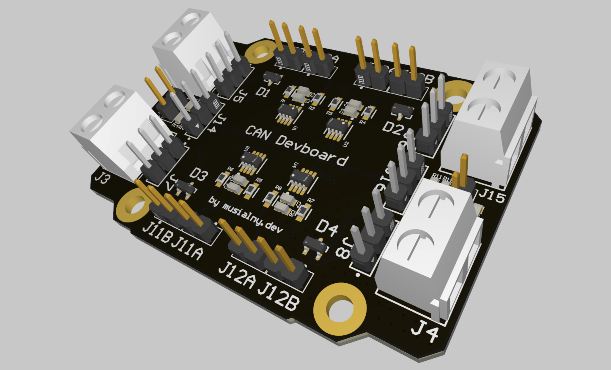

# Łukasz Musiał | musialny.dev

Software Engineer – Data Visualization & Cloud Infrastructure | Embedded & EV Electronics (DGUV 3E, SEP G1)

Software engineer working across data visualization, cloud infrastructure
and HV & LV control systems for electric vehicles.

---

## Work

### [Black Label](https://github.com/blacklabel) (2025 – present)

Data visualization software.

#### Seconded to Deepflare – FlareDesigner (2025–2026)
<table>
  <tr>
    <td width="50%" style="text-align: right;">
      
    </td>
    <td width="50%">
      

        FlareDesigner – a platform giving biologists without a technical background access to biotech ML models.
      

      <ul>
        <li>Developed the entire frontend, including interactive molecular visualizations (<a href="https://molstar.org/">Mol*</a>, <a href="https://github.com/rcsb/rcsb-saguaro">RCSB Saguaro</a>)</li>
        <li>Developed backend microservices, including services wrapping model-running code and exposing a fixed set of parameters</li>
        <li>Set up CI/CD, the GCP configuration (mainly Cloud Run) and Kubernetes clusters on OVH</li>
        <li>Took over the orchestrator service that starts model runners on demand and runs them in parallel under load</li>
      </ul>
    </td>
  </tr>
</table>

---

### PK MechPower – Formula Student

<table>
  <tr>
    <td width="50%">
      

        EV HV &amp; LV control systems of an electric race car.
      

      <ul>
        <li>Overall control system architecture</li>
        <li>Vehicle software architecture</li>
        <li>Schematic and PCB design, including:
          <ul>
            <li>Shutdown Circuit control logic safety PCB</li>
            <li>High-power carrier board for the isolated HV–LV DC–DC converter</li>
            <li>LV power stage switching board: LV high-power DC–DC converter, battery ↔ SMPS power distribution</li>
            <li>Development PCBs for integrators testing the car's systems</li>
            <li>Subsystem circuits with open- and short-circuit detection, etc.</li>
          </ul>
        </li>
        <li>Schematic and PCB design reviews</li>
        <li>Review and implementation of embedded software and tests</li>
        <li>Technical support for the HV tractive system integration</li>
      </ul>
    </td>
    <td width="50%" style="text-align: right;">
      
    </td>
  </tr>
</table>

---

## Certifications

DGUV 209-093 2E/3E · SEP G1/E up to 1 kV

---

## Stack

**Software:** TypeScript, JavaScript, Vue.js, Nuxt, C++, C | CMake, Webpack, Vite, Yarn | Mol*, RCSB Saguaro 
Also familiar with the Elixir / Phoenix and Erlang ecosystems (not daily work); exploring ML – model inference, training and fine-tuning.

**Infrastructure (DevOps / SysOps):** Linux, Docker, Kubernetes, LXD/LXC, Proxmox, GCP (Cloud Run)

**Embedded & hardware:** ARM / RISC-V (ESP32, RPi Pico, STM32), AVR | C, Clang/LLVM, GCC | Altium Designer (PCB) | SPICE, SI/PI, EMI/EMC | VHDL, SystemVerilog (FPGA) 
Exploring: analog and digital ASIC design (XSchem, ngspice, KLayout).

---

## Projects

### CAN_Devboard

A board for testing multiple devboards and external devices on a CAN bus, used by the PK MechPower team.

In progress: vehicle telemetry (ESP32, live view), which will become
the base of a universal vehicle module with extension boards.

---

## How I work

[How I work](HOW_I_WORK.md) – design flow, code and testing rules.
